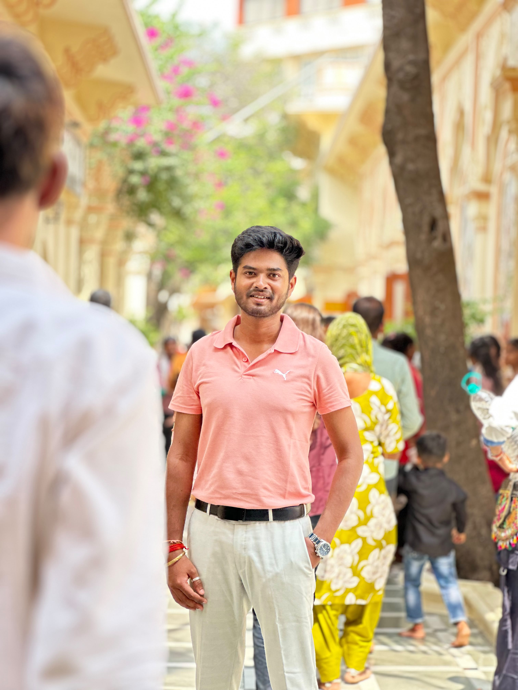

 

---

## 🙋‍♂️ About Me

- 🎓 Final-year **BTech CSE** student at **KL University**, Vaddeswaram — CGPA **9.18**
- 🌾 **Team Lead** of a 4-member capstone team building **ClimateRice-AI** — an AI system for climate resilience in agriculture (multimodal rice-yield prediction for Indian districts, live in production)
- 💼 Selected as **Digital Specialist Engineer (Trainee)** at **Infosys** — ₹6.25 LPA + ₹75K joining bonus
- 🛠️ I build with **Java · Spring Boot · Python · FastAPI · MySQL**, and hold **ServiceNow CSA + CAD** certifications
- 🧠 Keen interest in **DSA / algorithmic problem solving**
- 🎯 Preparing for **GATE CS 2027** (IIT Madras)
- 📍 Andhra Pradesh, India

<b>🎯 What I'm working towards</b>

 

- 📝 **GATE CS 2027** (IIT Madras) — deep in preparation alongside the final year
- 🏢 Joining **Infosys** as a Digital Specialist Engineer after graduation (2027)
- 📄 Publishing the ClimateRice-AI work — turning the capstone into a research paper
- 🌱 Levelling up on system design and full-stack development

 

---

## 🚀 Featured Projects

**🌾 ClimateRice-AI** — FastAPI + React system that predicts Kharif rice yield for 25 districts from measured weather (NASA POWER), satellite vegetation (MODIS) and recorded yield history (DES APY). Deployed model: an observational FusionNet with split-conformal prediction intervals, live season estimates refreshed weekly, a farmer dashboard that answers questions by voice in English, Hindi and Telugu, and Telegram season alerts.
🔗 Live: [frontend-gilt-chi-35.vercel.app](https://frontend-gilt-chi-35.vercel.app) · [API](https://climaterice-api.onrender.com/api/v1/health)

<b>📌 More about the capstone — Project 19, "AI for Climate Resilience in Agriculture"</b>

 

- Five objectives: climate-impact prediction (ISO 14090), water management advisory (ISO 14044), crop-variety recommendation, pest/disease alerts, and a farmer dashboard (ISO 9241)
- Genuine observational panel: 427 district-year rows, 12 districts, 2000–2024 — no synthetic yields in the deployed model
- Recorded yields end at 2024; 2025–2026 are clearly labelled weather-observed season **estimates**
- Mentored by **Dr. E. Raveendra Reddy**, Dept. of CSE, KL University
- Team: Rajesh Nemalipuri · Laxmi Pavani · Mullapudi Pravallika

<b>🏅 Certifications & highlights</b>

 

- **ServiceNow** Certified System Administrator (CSA) + Certified Application Developer (CAD)
- Built **Volunteer Connect** (ServiceNow) for HackNow 2026
- **AI Trip Planner** — Flask / React / Gemini
- **Car Rental System** — Spring Boot / React / MySQL

---

## 🧰 Tech Stack

---

## 📊 GitHub Stats

---

## 🐍 My Contributions, Eaten Fresh Daily

<picture>
  <source media="(prefers-color-scheme: dark)" srcset="https://raw.githubusercontent.com/piyrk/piyrk/output/github-contribution-grid-snake-dark.svg" />
  <source media="(prefers-color-scheme: light)" srcset="https://raw.githubusercontent.com/piyrk/piyrk/output/github-contribution-grid-snake.svg" />
  
</picture>

---

## 🤝 Connect With Me

 

